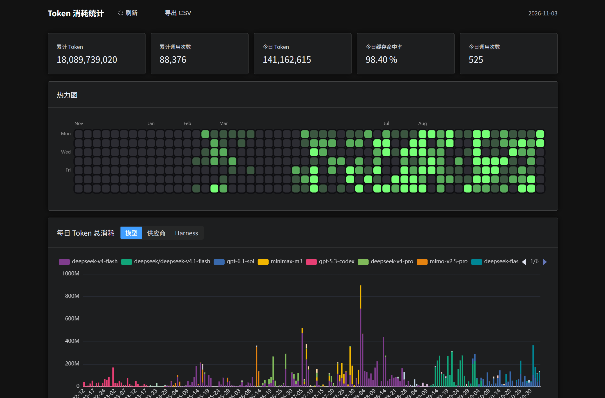
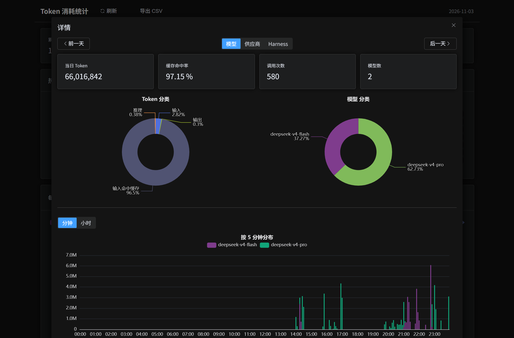

# Token Consumption

一个桌面小工具，把 **pi**、**opencode**、**Codex CLI** 的 token 用量汇总到一起，一眼看清每天花了多少、花在哪个模型上。




## 功能

- **总览卡片** — 累计 Token、今日 Token、缓存命中率、调用次数
- **全年热力图** — 一眼看出哪天用得多，点击任意格子看当天详情
- **每日用量** — 堆叠柱状图展示每天的消耗，支持缩放
- **每日占比** — 100% 堆叠图，看各分组占比怎么变化
- **三个视角** — 一键在 **模型 / 供应商 / Harness**（数据来自哪个客户端）之间切换
- **详情弹窗** — 当天 token 构成、分组分布、按 5 分钟或按小时的时间分布
- **导出 CSV** — 需要自己分析时，一键导出完整明细

## 下载

到 [Releases](https://github.com/fyc09/token-consumption/releases) 下载对应平台的文件，解压即用，无需安装：

| 平台 | 文件 |
|---|---|
| Windows x64 | `Token Consumption-*-win32-x64.exe` |
| Windows arm64 | `Token Consumption-*-win32-arm64.exe` |
| macOS（Intel / Apple Silicon） | `Token Consumption-*-darwin-universal.zip` |
| Linux x64 | `Token Consumption-*-linux-x86_64.AppImage` |
| Linux arm64 | `Token Consumption-*-linux-arm64.AppImage` |

## 数据来源

启动后会自动读取本机已有的数据，无需任何配置：

| 来源 | 位置 |
|---|---|
| pi | `~/.pi/agent/sessions/` |
| opencode | `~/.local/share/opencode/opencode.db` |
| Codex CLI | `~/.codex/sessions/`、`~/.codex/archived_sessions/` |

用哪个就统计哪个，没有的会自动跳过。数据每分钟自动刷新。

## 从源码运行

```bash
npm install
npx electron-builder install-app-deps
npm run dev
```

打包：

```bash
npm run package
```

## 许可

MIT
